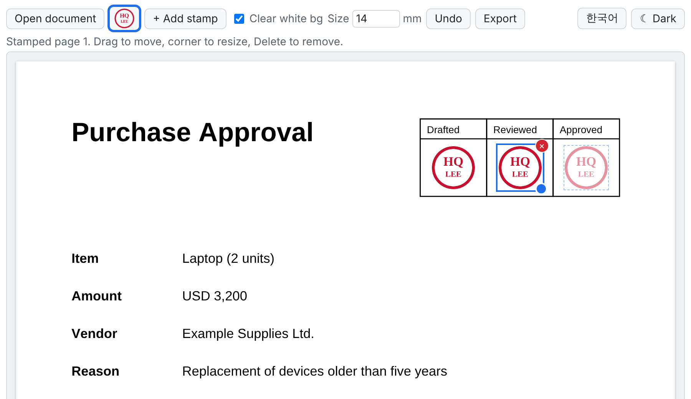

# 결재 도장 (approval-stamp-mcp)

AI 채팅 앱(Claude, ChatGPT) 안에서 [MCP App](https://github.com/modelcontextprotocol/ext-apps)으로 돌며, PDF나 이미지에 내 도장(인감, 서명 이미지)을 직접 찍습니다.

에이전트는 앱을 열기만 합니다. **에이전트는 도장을 찍을 수 없습니다.** 문서를 읽고 한 번씩 직접 찍는 것이 목적이고, 도장을 찍는 일이 내용을 한 번 더 검토하는 일이 됩니다.



## 설치

계정이나 로그인이 필요 없습니다. 주소: `https://approval-stamp-mcp.vercel.app/mcp`

- **Claude** (웹, 데스크톱, 모바일): 설정 → 커넥터 → **사용자 지정 커넥터 추가** → 이름 `결재 도장`, URL은 위 주소. 대화에서 **+** → 커넥터에서 켭니다.
- **ChatGPT**: 설정 → 앱 → 고급 설정에서 **개발자 모드**를 켜고, 위 주소로 앱을 만듭니다. 인증은 **없음**.
- **Claude Code**: `claude mcp add --transport http approval-stamp https://approval-stamp-mcp.vercel.app/mcp`
- **Codex 등 다른 MCP 클라이언트**: 원격(Streamable HTTP) MCP 서버로 추가합니다. 화면은 MCP Apps를 지원하는 앱에서만 보입니다.

안내: [approval-stamp-mcp.vercel.app](https://approval-stamp-mcp.vercel.app/#ko) · [개인정보처리방침](https://approval-stamp-mcp.vercel.app/privacy#ko) · [이용약관](https://approval-stamp-mcp.vercel.app/terms#ko) · [English README](README.md)

## 사용법

1. "결재 도장 앱 열어 줘"라고 요청합니다.
2. PDF나 이미지(PNG, JPEG, WebP)를 열거나 붙여넣거나 끌어다 놓습니다.
3. 도장 이미지를 한 번 추가합니다. 사진이나 스캔도 됩니다. 흰 배경은 투명해지고 여백은 잘립니다.
4. 마우스를 올리면 미리 보이고, 클릭하면 찍힙니다. 끌어서 옮기고, 모서리로 크기를 바꾸고, Delete로 지우고, Ctrl+Z로 되돌립니다. 크기는 mm 단위입니다.
5. 내보내기: PDF는 원본에 도장만 더해 저장합니다(글자는 글자 그대로, 회전된 페이지도 처리). 이미지는 원래 크기와 형식으로 저장합니다.

암호가 걸린 PDF는 열지 않습니다. 전자서명된 PDF는 경고와 함께 열립니다(도장을 더하면 기존 서명이 무효가 됩니다).

## 도구

| 도구 | 하는 일 |
| --- | --- |
| `open_stamp` | 도장 앱을 엽니다. 도장을 찍는 도구는 일부러 없습니다. |

## 개인정보

문서와 도장 이미지는 브라우저 밖으로 나가지 않습니다. 이 서버로도, AI 모델로도 보내지 않습니다. 도장은 내 브라우저의 로컬 저장소에만 보관됩니다.
내보낸 뒤 모델에는 "몇 쪽에 도장 몇 개" 한 줄만 전달됩니다. 서버에는 데이터베이스가 없고 아무것도 보관하지 않습니다.
전체 방침: [개인정보처리방침](https://approval-stamp-mcp.vercel.app/privacy#ko)

## 개발

```sh
npm install
npm test                    # UI 빌드, MCP 서버 검사, 브라우저 테스트(Playwright + Chromium 필요)
node test/listing-shots.cjs # 디렉터리용 스크린샷 docs/listing/*.png 생성
```

문의와 버그 신고: [GitHub Issues](https://github.com/hughqlee/approval-stamp-mcp/issues)
