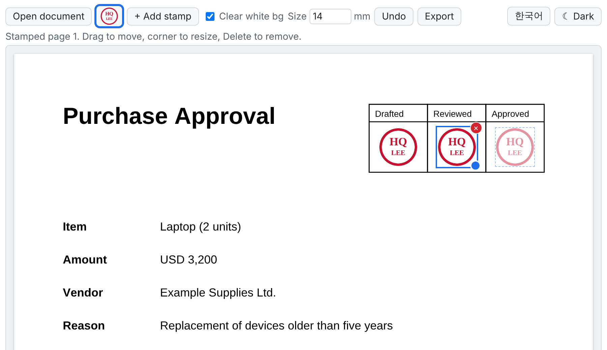

# approval-stamp-mcp

Put your own stamp (seal, signature image) on a PDF or image, by hand, inside AI chat apps (Claude, ChatGPT) as an [MCP App](https://github.com/modelcontextprotocol/ext-apps).

The agent only opens the app. **It cannot place a stamp**: you read the document and put each stamp down yourself, which is the point — stamping becomes one more review of the content.



## How it works

- Open, paste or drop a PDF or image (PNG, JPEG, WebP) in the app. Pages render with pdf.js in the browser.
- Add your stamp image once (photo or scan is fine: the white background is made transparent and the image is cropped).
  It is kept in this browser's storage (`localStorage`) and is **never sent to the server or the agent**.
- Hover shows a preview; click to stamp. Drag to move, corner handle to resize, `Delete` to remove, `Ctrl+Z` to undo. Size is set in mm.
- A counter shows how many pages you have actually scrolled through.
- Export (via `ui/download-file`):
  - PDF: the original PDF with the stamp images added (pdf-lib). Text stays text; rotated pages are handled.
  - Image: same size and format (JPEG stays JPEG, otherwise PNG).
- The agent only gets a one-line summary after export ("3 stamps on pages 1, 2"), never the document or the stamp.
- English / Korean and light / dark follow the host until the user toggles them.

Not supported: encrypted / password-protected PDFs (refused), PDF form filling. Digitally signed PDFs open with a warning,
because adding a stamp invalidates the existing signature.

Scanned PDFs (CCITT fax, JBIG2, JPEG 2000 images) render with pdf.js's plain-JS decoders, which `build.mjs` bundles in:
pdf.js normally uses WebAssembly or a dynamic import for them, and the default MCP Apps CSP blocks both.

## Tools

| Tool | Purpose |
| --- | --- |
| `open_stamp` | Opens the stamp app. There is deliberately no tool to place stamps. |

## Develop

```sh
npm install
npm test          # builds the UI, checks the MCP server, runs the browser test (needs Playwright + Chromium)
node test/screenshot.cjs   # regenerates docs/*.png
```

`npm run build` bundles `src/ui.js` (with pdf.js, pdf-lib and the Korean CMaps) into one HTML string at `lib/ui-html.js`,
which `lib/server.js` serves as `ui://stamp/app.html`. pdf.js runs its worker on the main thread because the default
MCP Apps CSP blocks worker scripts and fetch.

## Deploy

Vercel: `api/mcp.js` exposes the server; `vercel.json` rewrites `/mcp` to it. Add `https://<your-deployment>/mcp` as a custom connector in Claude.
